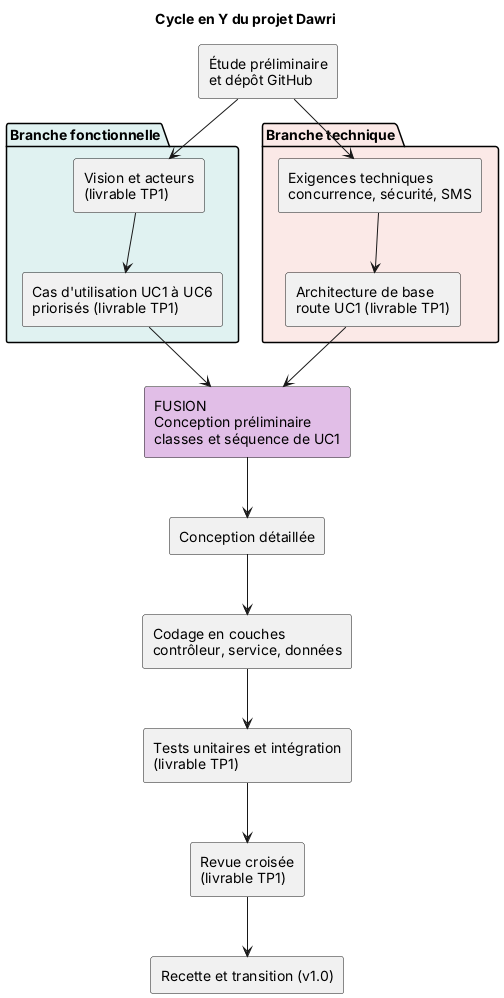

# Exigences, cycle en Y et questions

## 1. Exigences du projet Dawri

| Exigences fonctionnelles | Exigences techniques |
|---|---|
| **F1** Le client prend un ticket en choisissant un service dans un bureau (UC1). | **T1 Performance et concurrence** : des numéros uniques même avec 200 demandes simultanées, et une position mise à jour en moins de 3 secondes. |
| **F2** Le client voit sa position et une attente estimée (UC2). | **T2 Plateforme** : application mobile multiplateforme (Android en priorité) et interface web pour les agents et le responsable. |
| **F3** Le client est notifié quand il reste 3 personnes avant lui, puis quand il est appelé (UC3). | **T3 Sécurité** : connexion par numéro de téléphone avec code SMS, HTTPS, et prise de ticket limitée à la présence au bureau (QR code ou géolocalisation). |
| **F4** L'agent appelle le client suivant et le marque servi ou absent (UC4). | **T4 Intégration** : passerelle SMS d'un opérateur, notifications push (Firebase) et liste des bureaux et services de la Poste. |
| **F5** Le client annule ou reporte son ticket (UC5). | **T5 Disponibilité** : 99 % pendant les horaires d'ouverture, avec un repli par SMS si le client n'a pas de données mobiles. |
| **F6** Le responsable consulte l'affluence et l'attente moyenne par service (UC6). | **T6 Ergonomie** : interface en arabe et en français, simple pour tous les usagers. |

## 2. Le Y du projet

Le schéma est dans `docs/uml/cycle_en_y.puml` (source PlantUML) et `docs/uml/cycle_en_y.png` (image).

- **Branche fonctionnelle** : la vision et les acteurs, puis les cas d'utilisation UC1 à UC6 priorisés.
- **Branche technique** : les exigences techniques, puis l'architecture de base (route UC1 de bout en bout et test en CI).
- **Fusion** : la conception préliminaire de UC1, où l'on croise les besoins du client et les contraintes techniques pour dessiner les classes et le diagramme de séquence.
- **Tronc commun** : conception détaillée, codage en couches, tests unitaires et d'intégration, revue croisée, puis recette et transition (v1.0).

## 3. Questions

### Quelle contrainte technique a influencé le choix de l'UC à risque ?

La contrainte de concurrence. La file d'attente est une ressource partagée : des centaines de clients et plusieurs agents la modifient en même temps. UC1 (prendre un ticket) est le point d'entrée de cette file. Si deux clients reçoivent le même numéro, le suivi, la notification et l'appel par l'agent deviennent faux.

C'est pourquoi UC1 est l'UC à risque, plutôt que UC3 (notifications) : UC3 dépend d'un fournisseur SMS externe, difficile à tester dans un premier squelette, alors que UC1 se teste simplement (50 clients simultanés doivent obtenir les numéros 1 à 50, sans doublon).

Parade retenue : le numéro est attribué par la base de données dans une transaction verrouillée, une contrainte d'unicité (bureau, service, jour, numéro) empêche tout doublon, et un client ne peut avoir qu'un seul ticket en attente par service. UC1 a été réalisé de bout en bout dès l'élaboration, avec son test en intégration continue.

### Qu'auriez-vous changé avec une application mobile hors-ligne ?

Le risque se déplacerait de la concurrence vers la synchronisation.

- **Création du ticket** : sur le téléphone, avec un numéro provisoire, confirmé par le serveur au retour du réseau.
- **Conflits** : deux téléphones hors-ligne pourraient prendre un ticket au même moment. Le serveur attribuerait le vrai numéro à la synchronisation, et l'API tolérerait les requêtes répétées.
- **Données** : une base locale sur le téléphone serait nécessaire.
- **Notifications (UC3)** : par SMS plutôt que par notification push, car le SMS ne demande pas de connexion de données.
- **Suivi (UC2)** : plus de temps réel, on afficherait la dernière position connue avec son heure de mise à jour.
- **UC à risque** : ce serait « Synchroniser les tickets hors-ligne », et la priorisation des UC serait refaite.
